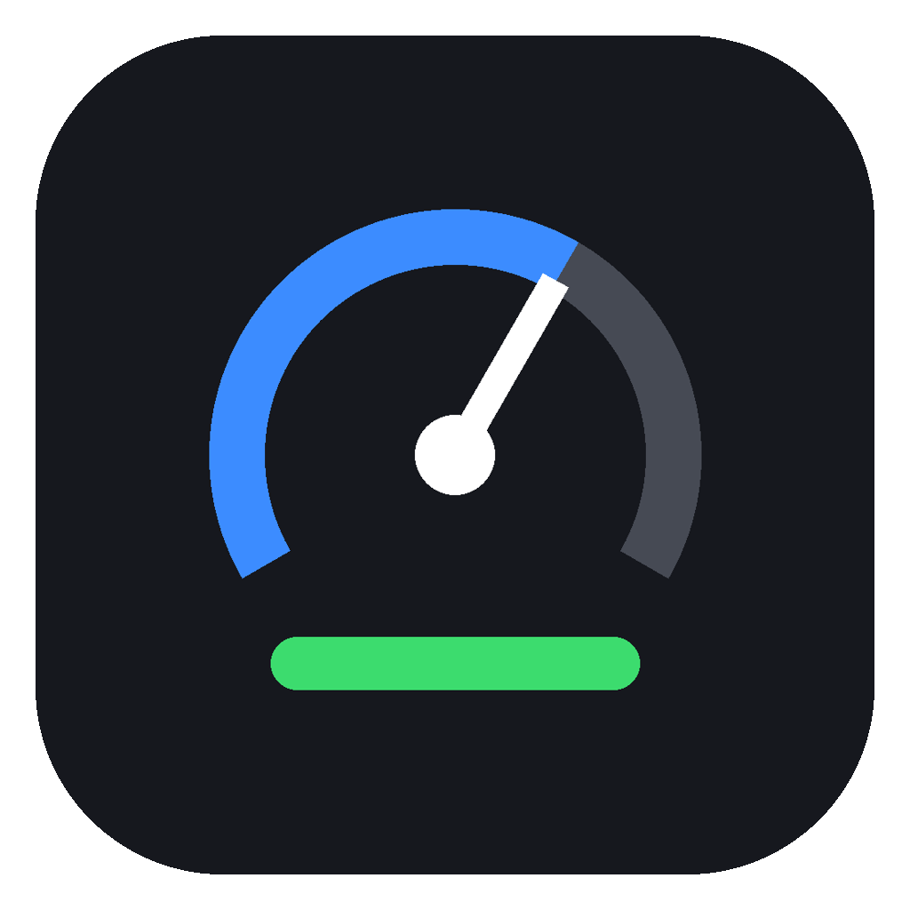
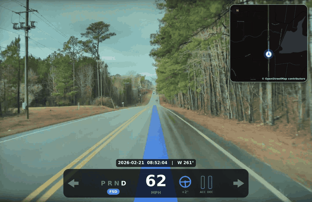
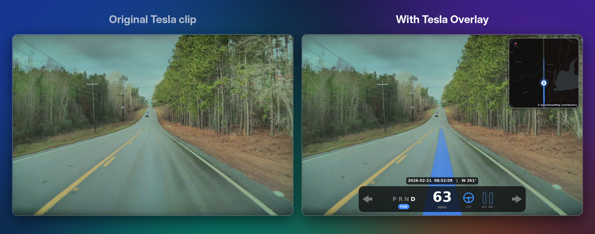
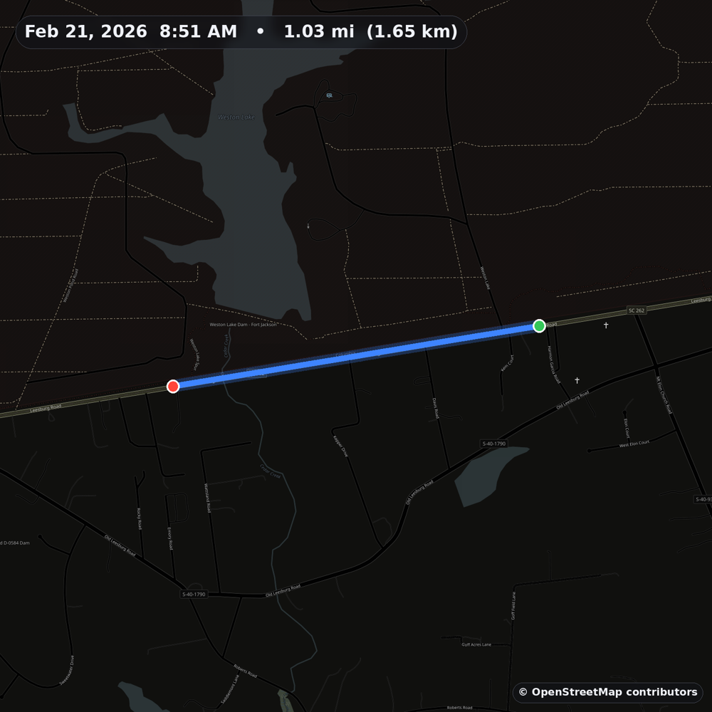
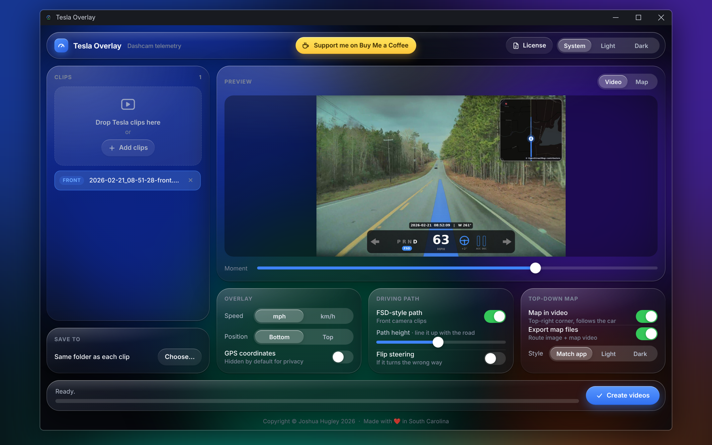
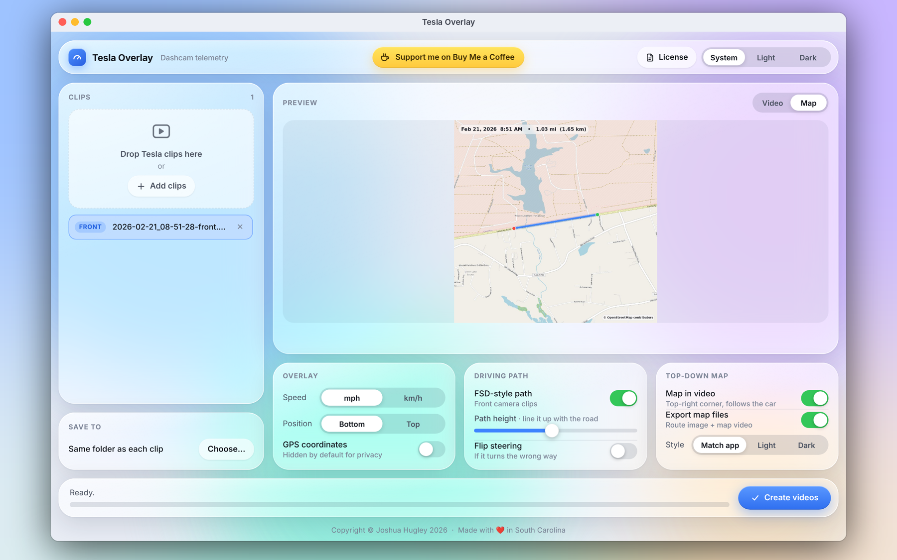

<p align="center">
  
</p>

<h1 align="center">Tesla Overlay</h1>

<p align="center">
  Turn Tesla dashcam clips into videos with your speed, an FSD-style driving path and a live map, burned right in.<br>
  For Windows and Mac · Free and open source
</p>

<p align="center">
  <a href="../../releases/latest"><b>Download the latest release</b></a> ·
  <a href="https://buymeacoffee.com/joshuah1998">Buy me a coffee</a> ·
  <a href="https://tesla.com/get-app/referral?code=joshua437896">Get FSD with my referral</a>
</p>

<p align="center">
  
</p>

## What it does

Every Tesla dashcam clip recorded on recent firmware carries hidden, frame-by-frame driving data: speed, gear, steering angle, pedals, turn signals, Autopilot state and GPS. Tesla Overlay reads it and makes a new copy of your video with that data drawn on top, the way the car saw the drive. Your original clip is never changed.

<p align="center">
  
</p>

**Speed panel.** Speed in mph or km/h, gear, steering wheel angle, flashing turn signals, an FSD, Autosteer or TACC badge, and two bars. While you drive, the bars show your accelerator and brake pedals. While FSD is driving, they switch to what the car itself is doing: green as it speeds up, red as it slows down. The date, time and compass heading sit just above.

**FSD-style driving path.** A blue line painted on the road showing where the car went over the next few seconds, built from the car's recorded heading and speed. Solid while driving, faded while slowing, with a white stop line where the car came to rest. Front camera clips.

**Live map in the corner.** A heading-up mini map that turns with the car like a navigation screen, with the route you've driven in blue.

**Route maps.** Export a map image of the whole drive, with distance, and an animated map video the same length as the clip.

<p align="center">
  
</p>

## Screenshots

<p align="center">
  
</p>
<p align="center">
  
</p>

## Download

Get the files from the [latest release](../../releases/latest).

| Platform | File | Notes |
| --- | --- | --- |
| Windows 10 and 11 | `TeslaOverlay-1.0.0-windows.zip` | Unzip and run `TeslaOverlay.exe`. On the SmartScreen prompt, click More info, then Run anyway. |
| macOS 11 or newer (Apple Silicon and Intel) | `TeslaOverlay-1.0.0-mac.zip` | Unzip and move Tesla Overlay to Applications. The first time, open it, then go to System Settings > Privacy & Security and click Open Anyway. |

The apps aren't signed with paid developer certificates yet, which is why Windows and macOS ask before the first launch.

## Which clips work

Tesla embeds this data in Dashcam clips (SavedClips and RecentClips, not SentryClips) recorded on firmware 2025.44.25 or later, on HW3 or newer. Frames recorded while parked may have no data. Every camera file carries the same data, and the driving path is drawn on front camera clips. You can use clips straight from the TeslaCam USB drive or ones downloaded from the Tesla app.

## Using it

Add one or more clips, check the preview, choose your options, and press Create videos. Each clip produces `<name>_overlay.mp4`, plus `<name>_map.png` and `<name>_map.mp4` if map export is on. Results are saved next to each clip, or in a folder you choose.

If the blue path doesn't sit on the road in your car, drag Path height in the preview until it does. Settings are remembered.

Maps need an internet connection the first time an area is mapped. Nothing else leaves your device; see [PRIVACY.md](PRIVACY.md).

## Command line

The desktop app also runs from a terminal:

```
python tesla_overlay.py clip1.mp4 clip2.mp4 [--kmh] [--top] [--gps] [--path] [--horizon=0.49]
                        [--flip-steering] [--map] [--map-corner] [--map-style=light|dark] [--no-map-video]
```

## Building from source

Install Python 3.12, then run `pip install -r requirements.txt` and `python tesla_overlay.py`, or double-click `run_windows.bat` or `run_mac.command`. Release builds are made with PyInstaller by the workflow in `.github/workflows/build.yml`.

## Support the project

Tesla Overlay is free. If it's useful to you:

- [Buy me a coffee](https://buymeacoffee.com/joshuah1998)
- Buying a Tesla or trying FSD? Use my [referral link](https://tesla.com/get-app/referral?code=joshua437896). It currently includes a free month of FSD; Tesla sets and changes referral rewards, so check the link for current terms.

## License

Tesla Overlay is released under the [MIT License](LICENSE).

It bundles FFmpeg (GNU GPL) and other open source components, and uses OpenStreetMap data (© OpenStreetMap contributors). Their licenses and source links are listed in [THIRD_PARTY_NOTICES.txt](THIRD_PARTY_NOTICES.txt), with full license texts in [licenses](licenses). The same information is in the app under License.

Tesla Overlay is an independent project and is not affiliated with, endorsed by or sponsored by Tesla, Inc. "Tesla" is a trademark of Tesla, Inc.

Copyright © 2026 Joshua Hugley. Made with ❤️ in South Carolina.
